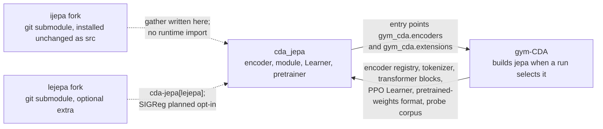

# cda_jepa

A JEPA encoder for [gym-continuousDoubleAuction](https://github.com/ChuaCheowHuan/gym-continuousDoubleAuction),
as an installable extension, built on the I-JEPA and LeJEPA authors' code.

A Joint-Embedding Predictive Architecture predicts the latents of masked parts of its input from
the visible parts, scored against an EMA copy of itself, and reconstructs nothing. Here the input
is gym-CDA's order-book observation, and the objective is an auxiliary loss on PPO's encoder, with
an optional action-conditioned world model and an offline pretrainer. It was part of gym-CDA until
it moved here; [docs/migration.md](docs/migration.md) covers what changed.

- Assran et al., *Self-Supervised Learning from Images with a Joint-Embedding Predictive
  Architecture* (I-JEPA), CVPR 2023. Code: [ChuaCheowHuan/ijepa](https://github.com/ChuaCheowHuan/ijepa).
- Balestriero & LeCun, *LeJEPA: Provable and Scalable Self-Supervised Learning Without the
  Heuristics*, 2025. Code: [ChuaCheowHuan/lejepa](https://github.com/ChuaCheowHuan/lejepa).

## How it fits



gym-CDA's
[docs/30_extensions.md](https://github.com/ChuaCheowHuan/gym-continuousDoubleAuction/blob/master/docs/30_extensions.md)
draws all three extension packages and their forks.

## Install

gym-CDA is not on PyPI. Install it first, then this package:

```bash
pip install "gym_continuousDoubleAuction @ git+https://github.com/ChuaCheowHuan/gym-continuousDoubleAuction"
pip install "git+https://github.com/ChuaCheowHuan/cda_jepa"
```

pip fetches I-JEPA's fork (a git submodule) itself. Installing changes no run. LeJEPA is not in
the default wheel: nothing imports it yet, so `scipy` and the LeJEPA fork are installed only by
the optional `cda-jepa[lejepa]` extra.

## Enable

In the train config:

```json
"extensions_enabled": ["jepa"],
"encoder_type": "jepa",
"encoder_specs": {"jepa": {"mask_axis": "level"}}
```

The encoder's settings stay where gym-CDA's encoder settings live, under `encoder_specs.jepa`.
Every one has a default, so `{}` is enough; [docs/settings.md](docs/settings.md) lists them.
Selecting `jepa` without `"jepa"` in `extensions_enabled` is refused.

| | |
|---|---|
| Tokenisation | either gym-CDA book mode (`grid`, `levels`); `tokenization` `both`, `time` or `level` |
| Learners | any number; the Learner unwraps RLlib's DDP wrapper before reading the encoder config (#6). The loss is computed on the actor's encoder only |
| Composition | `CDAJEPALearner` subclasses gym-CDA's PPO Learner and keeps the MoE term; other extensions' mixins (CBP) wrap it |
| World model | `"world_model": true` adds `Columns.NEXT_OBS` to the train batch; nothing else does |
| Pretraining | `python -m cda_jepa.pretrain`, then `pretrained_encoder_path` ([docs/pretraining.md](docs/pretraining.md)) |
| Resumes | checkpoints written with gym-CDA's built-in `jepa` resume with this package installed ([docs/migration.md](docs/migration.md)) |

## Read the collapse metric before believing it works

A collapsed JEPA maps every observation to one latent, which makes its prediction loss zero and
reads as success. `jepa_latent_std` and `jepa_offdiag_cov` are the metrics meant to show it
([docs/metrics.md](docs/metrics.md)). `jepa_latent_std` is the per-dimension standard deviation
across the batch at each masked position, so it falls to near zero when the encoder ignores its
input; positional spread alone no longer keeps it high (#4). A healthy *trained* reading is above
0.1; a fresh encoder starts near zero. The pretrainer refuses to save a run below that.

## What comes from the forks

The forks ship unchanged, byte for byte from pinned commits: I-JEPA's `src` package installs by
default (a top-level package named `src`, because that is how the authors' code imports itself),
while LeJEPA's `lejepa` package installs only with `cda-jepa[lejepa]`. The encoder does not import
either at runtime: the one I-JEPA function it used, `apply_masks`, is a `torch.gather` now written
here, so a user's own `src/` package cannot shadow it (#5). The LeJEPA objective and I-JEPA's
block masks are planned as opt-in settings. [docs/provenance.md](docs/provenance.md) says what is
used, what is not, and why.

## Documentation

[docs/README.md](docs/README.md) indexes the rest.

## Compatibility

Needs gym-CDA 2.2 or later (`gym_continuousDoubleAuction>=2.2,<3`): 2.2.0 finds encoders through
the `gym_cda.encoders` entry point. [docs/development.md](docs/development.md) lists what this
package uses from gym-CDA.

## License

This package's own code is MIT, the same as gym-CDA, from which it came. The I-JEPA and LeJEPA
code is CC BY-NC 4.0 (non-commercial); see [NOTICE](NOTICE). I-JEPA ships in the default wheel;
LeJEPA is fetched only by `cda-jepa[lejepa]`. The encoder no longer imports either fork at runtime
(#5). Whether an MIT package should carry CC BY-NC code at all is
[#24](https://github.com/ChuaCheowHuan/cda_jepa/issues/24).
